# driver-guard

**Find the kernel drivers on your PC that attackers use to switch off antivirus.**

<p align="center"></p>

<p align="center"></p>

Ransomware gangs and RAT operators don't need their own kernel exploit. They drop a legitimately signed
but vulnerable driver (an old overclocking tool, a hardware monitor, an anti-cheat) and use it to kill
the antivirus, hide processes or read passwords from memory. This is "bring your own vulnerable driver",
and those drivers are often already on the PC, installed by a tuning utility years ago.

`driver-guard` lists every kernel driver Windows knows about and checks each one against
[LOLDrivers](https://www.loldrivers.io), the community catalogue of 700+ vulnerable and malicious
drivers. And because new BYOVD drivers appear faster than any catalogue, it also **reads what each driver
can do** (map physical memory, kill processes, touch other processes' memory, switch off kernel write
protection) and whether any program can ask it to: it finds weapon-shaped drivers no list knows yet.

```
$ driver-guard
 driver-guard 0.2.0  ·  440 drivers (171 running)  ·  LOLDrivers 713 entries, 0 days old
 vulnerable driver blocklist: on  ·  memory integrity: on
 not administrator: drivers loaded without a service entry are not listed

 HIGH     cpuz159_x64.sys  service cpuz159, running
          C:\WINDOWS\temp\cpuz159\cpuz159_x64.sys
          • BYOVD candidate: any program can ask it to map physical memory
            no catalogue lists this build, but it has what attack tools look for in a driver: a device
            ordinary programs can open by name (no access list), and kernel primitives behind it. Keep
            it only if you use the hardware or tool it came with; it also can: write CPU model-specific
            registers
          • driver kept in a folder ordinary programs can write to
            any program can swap this file, and drivers belong in Windows\System32\drivers or the driver
            store
            CPUID · CPUID service · 6.1.7600.16385 built by: WinDDK · signed by Microsoft Windows
            Hardware Compatibility Publisher

 MEDIUM   RTCore64.sys  service RTCore64, running
          C:\Program Files (x86)\MSI Afterburner\RTCore64.sys
          • BYOVD candidate: any program can ask it to map physical memory
            this exact build is not listed, but an earlier one with the same name is a known weapon
            (https://www.loldrivers.io/drivers/275c80c5-a67c-4536-b29e-4e481242cb01/), and this one
            still has what made it one: a device ordinary programs can open by name (no access list),
            and kernel primitives behind it. Keep it only if you use the hardware or tool it came with;
            it also can: write CPU model-specific registers
            signed by MICRO-STAR INTERNATIONAL CO., LTD.

 LOW      brynhildr.sys  service atvi-brynhildr_steam, stopped, start: manual
          C:\Program Files (x86)\Steam\steamapps\common\Call of Duty Modern Warfare\brynhildr.sys
          • BYOVD candidate: any program can ask it to switch off kernel write protection (CR0) and map
            physical memory and kill any process
            no catalogue lists this build, but it has what attack tools look for in a driver: a device
            ordinary programs can open by name (no access list), and kernel primitives behind it. Keep
            it only if you use the hardware or tool it came with; it also can: write CPU model-specific
            registers
            Activision Blizzard, Inc. · Brynhildr Driver · 1.0.0.0 · signed by Activision Publishing Inc
 1 high  8 medium  1 low
```

(A real run on the author's PC, trimmed to three drivers. None of these builds is in LOLDrivers, yet each
one hands any program a kernel primitive: a CPU-Z driver loaded from a world-writable folder, MSI
Afterburner's RTCore64, and a game anti-cheat that can kill processes and turn off CR0 write protection.)

## What it checks

| Check | Why it matters |
|---|---|
| **LOLDrivers by file hash** (SHA-256, SHA-1, MD5) | the exact file is a known weapon |
| **LOLDrivers by Authenticode hash** | the hash Windows itself uses: it ignores the signature and checksum, so a known driver re-signed or padded by an attacker still matches |
| **What the driver can do** (its imports and code) | a device any program can open by name, with physical memory mapping, process killing, cross-process memory access or a CR0 write behind it: the shape of every BYOVD driver, listed or not |
| Malicious vs vulnerable | a malicious match is malware on your PC; a vulnerable one is a door any program can use |
| Running or only installed | a loaded vulnerable driver is usable right now |
| Same name, different build | usually a fixed version; reported so you keep it updated |
| Signature (Windows' own verdict, catalog-signed files too) | unsigned or altered drivers |
| Location | a driver in Temp, a user folder or ProgramData can be swapped by any program |
| Odd names | no `.sys` extension, random hex names: how some tools and droppers hide drivers |
| Running driver whose file is gone | rootkits delete their file after loading |
| Blocklist and memory integrity | whether Windows would refuse a known vulnerable driver at all |

**How the capability check works.** A driver is only a weapon when two things meet: user mode can reach it,
and it does something dangerous on request. `driver-guard` reads the import table and the code of each
driver. *Reachable* means it creates a symbolic link to its device without an access list
(`IoCreateSymbolicLink` without `IoCreateDeviceSecure`). *Dangerous* means `MmMapIoSpace`, `ZwTerminateProcess`,
`MmCopyVirtualMemory`, `KeStackAttachProcess`, `\Device\PhysicalMemory` or `mov cr0` in its code. Plug and Play
hardware drivers (GPU, audio, storage) are left out: they map physical memory for good reasons, and user mode
reaches them through device interfaces whose access the device class controls. Windows' own drivers are
left out too.

Measured on a real PC: of 440 drivers, it flagged 10. Nine are small "I/O library" drivers from tuning,
RGB and monitoring tools (RTCore64, AsIO3, MsIo64, NTIOLib, IOMap64 and three CPU-Z builds among them), the
families BYOVD attacks use. The tenth is a game anti-cheat. The NVIDIA and Realtek drivers, which also map
physical memory, were correctly left alone.

The Authenticode hash is computed by `driver-guard` itself and tested against Windows'
`Get-AppLockerFileInformation` on real system drivers.

## Use

```
driver-guard                       # every driver on this PC
driver-guard C:\suspicious\        # driver files or folders (works on Linux and macOS too)
driver-guard --json                # machine-readable
driver-guard --all                 # also informational findings
driver-guard --update              # refresh the LOLDrivers catalogue
driver-guard --offline             # never download
driver-guard --db drivers.json     # a LOLDrivers drivers.json you already have
```

Exit codes: `0` nothing at `--fail-on` level (default `high`) or worse, `1` found, `2` could not run.
The catalogue (about 36 MB) is downloaded once and kept as a small index in
`%LOCALAPPDATA%\driver-guard`.

Run it as administrator to also see drivers loaded without a service entry; without it, everything
registered as a service is still checked.

```
pip install git+https://github.com/njuj/driver-guard
```

or `python -m driverguard` from a clone. Python 3.10+, no dependencies.

## If it finds something

- **Vulnerable driver:** uninstall or update the program that installed it, then turn on
  Windows Security → Device security → Core isolation → *Microsoft Vulnerable Driver Blocklist*
  (and *Memory integrity*).
- **Malicious driver:** the PC is compromised. Back up your files and reinstall Windows.

`driver-guard` changes nothing on the system: it only reads.

## Tests

```
python -m unittest discover -s tests -t . -v
```

Catalogue lookups and every rule are tested against a made-up catalogue. The capability reader is tested on
minimal driver images built in the test (an open device with each weapon, an access list, a PnP driver, a
`wrmsr` byte pair alone, a Windows-signed driver) and on 400 randomly damaged files; on Windows the Authenticode
hash is checked against Windows' own on real drivers, and the live inventory is read.

## License

MIT
